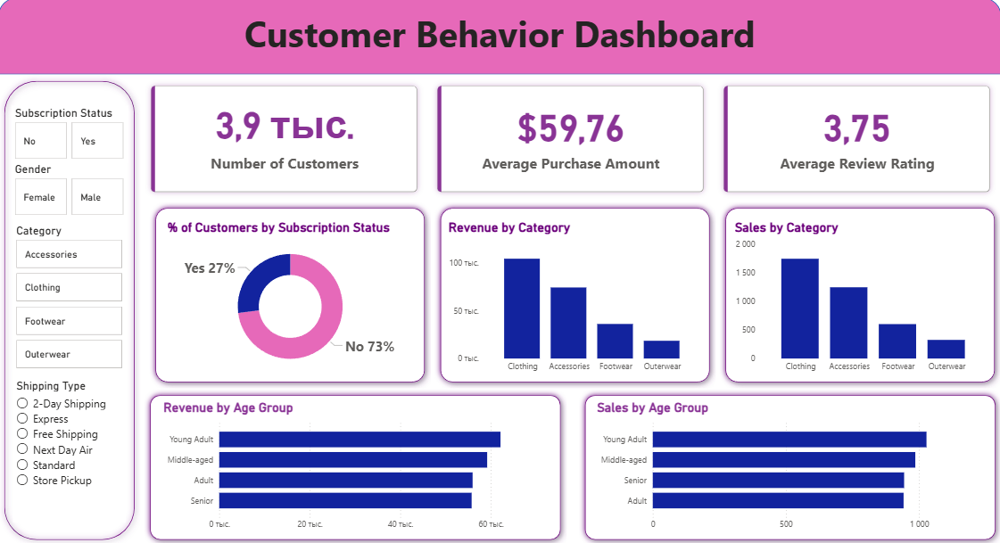

# 🛍 Customer Shopping Behaviour Analysis

Сквозной анализ покупательского поведения 3 900 клиентов розничной сети: от очистки данных до интерактивного дашборда и презентации с рекомендациями для бизнеса.


## 🎯 Цель

Выявить ключевые драйверы продаж, сегментировать клиентскую базу и предложить стратегии роста выручки и лояльности.

## 🖼 Дашборд



## 🔧 Что сделано

| Этап | Инструменты | Результат |
|:---|:---|:---|
| Очистка и подготовка данных | Python (pandas, numpy) | Обработаны пропуски (37 в колонке рейтинга), приведены типы, переименованы столбцы, созданы признаки: возрастные группы и частота покупок |
| Анализ и SQL-запросы | MySQL | Сформированы витрины данных и выполнены 10 бизнес-запросов: от выручки по полу до сегментации клиентов и доли дисконтных продаж по товарам |
| Визуализация | Python (matplotlib, seaborn), Power BI | Интерактивный дашборд с трендами, распределениями и ключевыми метриками |
| Отчёт | Презентация (Gamma) | Выводы и практические рекомендации для маркетинга и управления ассортиментом |

## 📈 Ключевые результаты

- **Экспресс-доставка.** Клиенты с экспресс-доставкой тратят в среднем на 3,4% больше: 60,48 USD против 58,46 USD.
- **Скидки.** У 5 товаров доля дисконтных продаж выше 47% (Hat, Sneakers, Coat, Sweater, Pants). Стоит пересмотреть ценовую политику по этим позициям.
- **Сегменты клиентов:**

  | Сегмент | Клиентов |
  |:---|---:|
  | Loyal | 3 116 |
  | New | 833 |
  | Returning | 701 |

  Для каждого сегмента предложены механики удержания (см. презентацию).
- **Рекомендации по ассортименту.** Определены топ-3 товара в каждой категории (например, в «Одежде» это Blouse, Pants, Shirt), их можно использовать в рекомендательных системах.

## 📁 Структура репозитория

```
├── data/
│   └── customer_shopping_behavior.csv        # исходный датасет
├── notebooks/
│   └── Customer_Shopping_Behaviour_Analysis.ipynb   # очистка данных и EDA
├── sql/
│   └── customer_behaviour_analysis.sql       # 10 бизнес-запросов
├── dashboard/
│   └── customer_behaviour_analysis.pbix      # дашборд Power BI
├── presentation/
│   └── Customer-Shopping-Behavior-Analysis.pdf
├── images/
│   └── dashboard.png
└── README.md
```

## ▶️ Как воспроизвести

1. Скачайте датасет (источник указан ниже) и положите в папку `data/`.
2. Установите зависимости: `pip install pandas numpy matplotlib seaborn jupyter`.
3. Откройте ноутбук из `notebooks/` и выполните ячейки сверху вниз, чтобы получить очищенные данные.
4. Загрузите очищенные данные в MySQL и выполните запросы из `sql/`.
5. Откройте файл из `dashboard/` в Power BI Desktop.

## 📚 Данные

Источник датасета: *(вставьте ссылку и название)*. 3 900 записей о покупках клиентов розничной сети.

## 📄 Презентация

[Открыть презентацию](./presentation/customer-behaviour.pdf) · 
